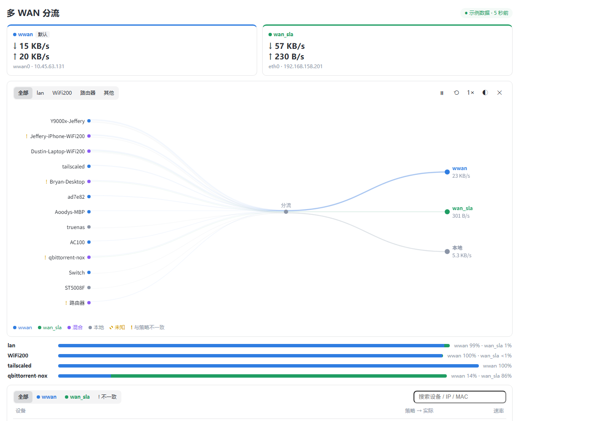
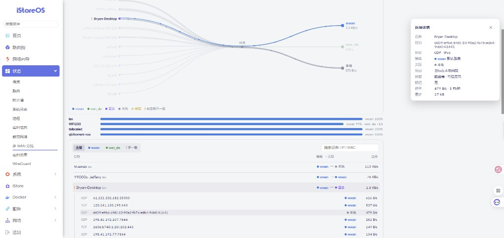
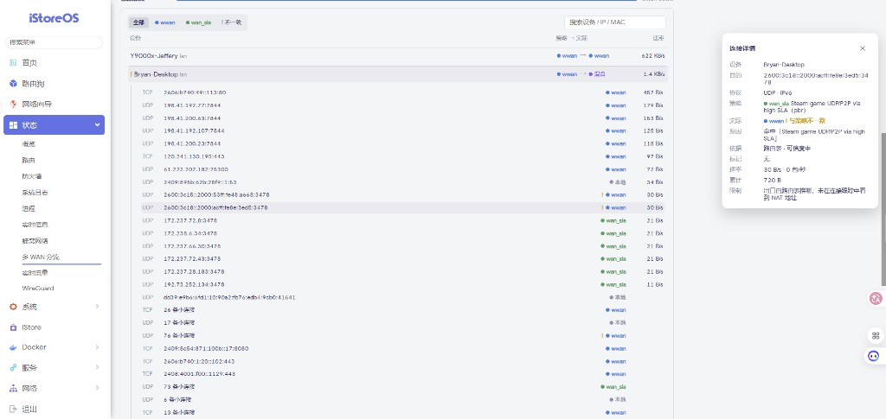
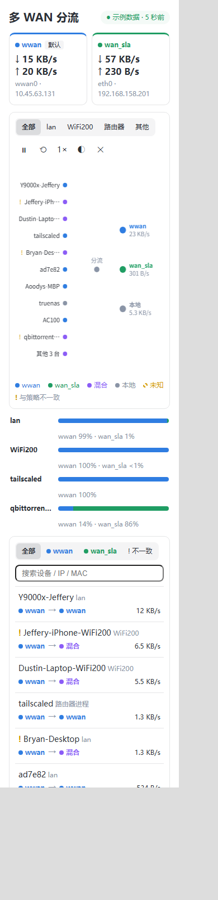

# luci-app-wan-flow-monitor

OpenWrt / iStoreOS（fw4/nftables）的只读多 WAN 流量可视化页面。任意数量的 WAN、任意接口名、任意局域网段都可以用。接口、网段、策略和路由器进程都在运行时读取，没有写死的名称。

它回答三个问题：

1. 每条线路现在有多少流量？（每个出口一张卡片）
2. 谁在用哪条线路？（实时拓扑，以及每个网段、路由器进程的比例条）
3. 这和分流策略一致吗？（设备列表显示 `策略 → 实际`，`!` 表示不一致）

菜单位置：**状态 → 多 WAN 分流**（`admin/status/wan-flow-monitor`）。

## 真实场景展示

下面全部来自实际运行中的 iStoreOS 路由器。“示例数据”表示把同一批真实采样载入本地预览页，不是随机生成的流量。

**多 WAN 总览：** 自动发现 `wwan` 与 `wan_sla`、默认出口、LAN / Wi-Fi 网段和路由器进程，并按实测速率绘制拓扑。



**设备路径高亮：** 选中 `Bryan-Desktop` 后，只强调该设备到分流节点，再到 `wwan` / 本地目的地的真实路径；右侧同时显示连接依据和可信度。



**策略与实际出口不一致：** 此 Steam UDP 流量配置为 `wan_sla`，conntrack 观测到实际经 `wwan`，因此以 `!` 标出。展开后可检查规则、NAT / 路由依据和单连接速率。



**窄屏布局：** 390 px 宽度下仍保留出口卡片、拓扑、比例条、筛选和设备列表。



## 自动发现的内容

| 对象 | 发现方式 |
|---|---|
| WAN 出口 | 持有默认路由的 netifd 接口、开启 `masq` 的防火墙区域，或被 pbr / mwan3 规则引用的接口。共用同一个三层设备的接口（例如 `wan` + `wan6`）合并为一个出口 |
| 默认出口 | 主路由表中 metric 最低的默认路由，IPv4 / IPv6 分别判断。它排在最前，并使用第一种颜色 |
| 局域网段 | 已启用、有 IPv4、且运行 DHCP 或属于未开启 `masq` 区域的非 WAN 接口。同时记录 IPv4 子网和 IPv6 前缀 |
| 设备 | DHCP 租约 + 邻居表（仅网段桥）+ 静态 DHCP 主机名 + 策略引用的 MAC（离线也显示） |
| 路由器进程 | 路由器自身发起的连接，通过 `ss -ntup` 的已连接套接字和 `ss -lntup` 的监听端口归属到进程（例如 qBittorrent、Transmission、tailscaled） |
| 分流策略 | pbr（`/etc/config/pbr`）和 mwan3（`/etc/config/mwan3`），合并成一份有序规则列表 |

### 策略来源

- **pbr：** pbr 已加载 nft 规则后（规则注释等于策略名），按 nft 顺序匹配；域名策略使用已经解析好的 nft 集合。加载前则直接匹配 UCI 字段。`interface 'ignore'` 表示留在本地。
- **mwan3：** 每条规则经过 `use_policy` → member → interface。策略中 metric 最低的成员是配置出口；metric 相同的成员显示为 `a+b`（负载均衡）。`default` 表示主路由表。
- **没有策略：** 每条连接的策略都是默认出口。
- **接口不存在：** 引用了不存在接口的规则会列出缺失名称（`missingInterfaces`），并且不参与匹配，因为 pbr / mwan3 也不会安装这条规则。

## 实际出口如何判定

每条连接按下面的顺序检查，第一条命中的规则生效：

1. conntrack 中出现 WAN 地址：NAT 回包目的地址、入站连接的目的地址，或路由器自身流量的源地址。可信度：高。
2. 目的地在本地：回环、链路本地或组播、Tailscale 网段、路由器地址、局域网段。结果：本地。
3. conntrack 的 fwmark → `ip rule` → 该表的默认路由 → 设备 → 出口。可信度：高。
4. 主路由表最长前缀匹配。非 WAN 设备算作本地。可信度：中。
5. 默认路由。可信度：中。

不一致（`!`）表示已经知道配置出口，连接实际从另一个出口离开，而且两边都是 WAN 出口。

已知限制（页面的“限制”字段也会显示）：

- **隐藏的目的地：** DoH、DoT 和代理会隐藏真实域名与目的地址。
- **不一致的噪声：** 绑定到某个 WAN 地址的路由器进程（例如 BT 客户端）会走该地址所在出口，即使默认路由指向别处，因此会被标成不一致。

## 页面怎么读

| 元素 | 含义 |
|---|---|
| 出口卡片 | 实时 ↓/↑ 速率、设备 / IP，以及默认路由线路上的 `默认` 标记 |
| 拓扑 | 左侧设备 → 分流 → 右侧出口。线宽是真实字节/秒，粒子密度是真实包/秒；没有数据包的线路不显示粒子。点击右侧出口节点或连线，会高亮并筛选当前走该出口的全部设备 |
| 比例条 | 每个局域网段、以及使用 WAN 的路由器进程，其外部流量在各出口上的占比 |
| 设备列表 | `策略 → 实际`。点击一行展开连接，点击一条连接查看规则、依据和可信度 |
| 状态标记 | `● N 秒前` 实时 / `⚠ 已过期` 超过 15 秒 / `⏸ 已暂停` / `⟲ 回放` / `示例数据`（不是路由器实时数据） |

出口颜色按发现顺序分配：蓝、绿、橙、粉、青……紫色（混合）、灰色（本地）和黄色（未知，虚线）是保留色。颜色始终配有文字。

操作：

- ⏸/▶ 暂停；画面冻结，但仍可查看。
- ⟲ 回放最近 5 分钟。
- 速度在 0.5× / 1× / 2× / 4× 之间切换。
- ◐ 静态模式不显示粒子；系统开启 `prefers-reduced-motion` 时也会自动启用。
- ✕ 清除当前选择。
- 点击右侧出口节点或连线，只保留观测到该出口流量的设备；再点一次或按 Esc 取消筛选。

拓扑中，方向键移动焦点，回车选中设备，Esc 清除选择。

## 安全边界

- **只读：** 任何按钮都不会修改 pbr、mwan3、防火墙、接口、DNS 或任何应用。
- **固定命令白名单：** 后端只运行 `ip -j route/rule/neigh`、`nft -j list table inet fw4`、`conntrack -L -o extended` 和 `ss -H -ntup/-lntup`。请求不携带 shell 参数；`device_flows` 只把传入值和内存中的设备键做字符串比较。
- **最小 UCI 读取：** 只读与路由有关的字段：防火墙区域的 name/network/masq、DHCP 的 interface/ignore 和主机 name/mac/ip、pbr 策略，以及 mwan3 的 interface/member/policy/rule。可能包含密码或密钥的字段不会读取，也不会返回。
- **ACL：** `luci-app-wan-flow-monitor` 只授予 `wan_flow_monitor.{overview,history,device_flows,health}` 的读取权限。
- **转义：** 主机名、进程名、域名和 IP 都以 DOM 文本节点插入，或用 canvas `fillText` 绘制，不经过 innerHTML。
- **没有云服务，也不编造数据。** 失败时页面保留上一份有效数据，并显示结构化错误（⚠ N）。

## 依赖

`luci-base rpcd-mod-ucode ucode-mod-fs ucode-mod-uci ucode-mod-ubus ip-full ss conntrack nftables-json`

iStoreOS 默认没有 `ss`：`opkg update && opkg install ss`。

## 预编译包

GitHub Actions 使用 OpenWrt 24.10 SDK 为 x86_64、aarch64、arm、mips 和 riscv 编译。推送 `v*` 标签会发布 Release。

软件包是 `PKGARCH=all`：一个 `.ipk` 可以安装到所有架构。每个 `*_openwrt-24.10.tar.gz` 是对应架构 SDK 生成的 opkg 软件源（ipk 加上软件包索引）。

```sh
opkg install luci-app-wan-flow-monitor_*.ipk
```

## 安装

### 方式 A：编译 ipk

把本目录放到 OpenWrt SDK 的 `feeds/luci/applications/luci-app-wan-flow-monitor`，然后：

```sh
make package/luci-app-wan-flow-monitor/compile
opkg install luci-app-wan-flow-monitor_*.ipk
```

### 方式 B：直接复制文件

在仓库根目录执行：

```sh
ROUTER=root@192.168.1.1
ssh $ROUTER 'mkdir -p /usr/share/ucode/wan_flow_monitor /www/luci-static/resources/view/wan-flow-monitor /www/luci-static/resources/wan-flow-monitor'
scp root/usr/share/ucode/wan_flow_monitor/*.uc                    $ROUTER:/usr/share/ucode/wan_flow_monitor/
scp root/usr/share/rpcd/ucode/wan_flow_monitor.uc                 $ROUTER:/usr/share/rpcd/ucode/
scp root/usr/share/rpcd/acl.d/luci-app-wan-flow-monitor.json      $ROUTER:/usr/share/rpcd/acl.d/
scp root/usr/share/luci/menu.d/luci-app-wan-flow-monitor.json     $ROUTER:/usr/share/luci/menu.d/
scp htdocs/luci-static/resources/view/wan-flow-monitor/overview.js $ROUTER:/www/luci-static/resources/view/wan-flow-monitor/
scp htdocs/luci-static/resources/wan-flow-monitor/*                $ROUTER:/www/luci-static/resources/wan-flow-monitor/
ssh $ROUTER 'rm -f /tmp/luci-indexcache*; /etc/init.d/rpcd restart'
```

重启 rpcd 会结束现有 LuCI 登录，之后需要重新登录。修改样式表时，要同时增加 `overview.js` 里的 `ASSET_VERSION`；uhttpd 不发送 Cache-Control，浏览器否则会继续使用旧 CSS。

确认是否正常：

```sh
ubus call wan_flow_monitor health
SECOND_SAMPLE=1 ucode -S -L /usr/share/ucode tests/smoke-live.uc   # 打印发现到的出口、网段和规则
```

## 卸载 / 回滚

安装只增加上面列出的文件，不会改动 `/etc/config`。卸载就是删除这些文件：

```sh
rm -rf /usr/share/ucode/wan_flow_monitor \
       /www/luci-static/resources/view/wan-flow-monitor \
       /www/luci-static/resources/wan-flow-monitor
rm -f  /usr/share/rpcd/ucode/wan_flow_monitor.uc \
       /usr/share/rpcd/acl.d/luci-app-wan-flow-monitor.json \
       /usr/share/luci/menu.d/luci-app-wan-flow-monitor.json
rm -f  /tmp/luci-indexcache*
/etc/init.d/rpcd restart
opkg remove ss   # 可选，仅当 ss 只是为这个应用安装时
```

如果是用 ipk 安装的：`opkg remove luci-app-wan-flow-monitor`。

## 测试

- **固定样本：** `sh tests/run.sh`（需要 ucode，可在路由器或 SDK 中运行）。
  - `test-parsers.uc` 覆盖 conntrack / ss / nft / ip / DHCP 解析。
  - `test-topology.uc` 使用一套与开发路由器不同的拓扑：wan + wan6、lte、lan、guest，同时启用 pbr 和 mwan3。它检查发现、规则映射、负载均衡策略、缺失接口规则、不一致检测、进程归属和路由回退。
- **实机检查（只读）：**
  - `tests/smoke-live.uc` 显示发现结果。
  - `MISMATCH=1 ... tests/inspect-live-nft.uc` 显示规则归因统计和不一致的连接。
- **不登录即可预览页面：**
  1. 在路由器上运行 `ucode -S -L /usr/share/ucode tests/dump-live.uc`，把输出拆成 `overview.json`、`history.json` 和 `flows-<key>.json`，放到 `tests/harness/.local/`（已被 git 忽略）。
  2. 运行 `python -m http.server 8765`。
  3. 打开 `http://localhost:8765/tests/harness/`（`phone.html` 是 320 px 版本）。

  页面会显示 `示例数据`。

## RPC

| 方法 | 参数 | 返回 |
|---|---|---|
| `overview` | 无 | `exits`（含速率）、`defaultExit`、`segments`、`policy`（来源和规则）、`devices`（含路由器进程 / 主机及各出口流量）、最多 150 条活动 `flows`、数据源状态、错误 |
| `history` | `since`、`limit`（≤120） | 5 分钟环形缓冲，按设备 × 出口汇总 |
| `device_flows` | `device` | 该设备当前最多 100 条连接 |
| `health` | 无 | 是否有数据、数据是否过期、错误数量 |

缓存：conntrack 和套接字 3 秒，路由 5 秒，nft 15 秒，UCI 30 秒。连接超过 300 条时，速率最高的 250 条单独保留，其余按设备 / 协议 / 出口 / 规则合并。开发路由器上约 1700 条 conntrack 记录时，一次采样大约 0.4–0.5 秒。
